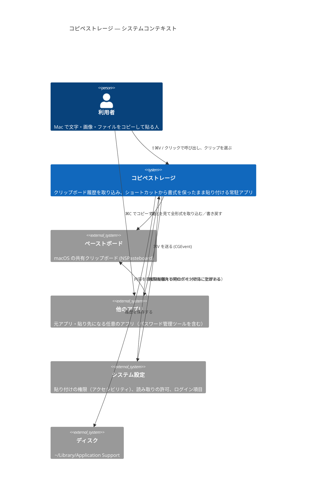
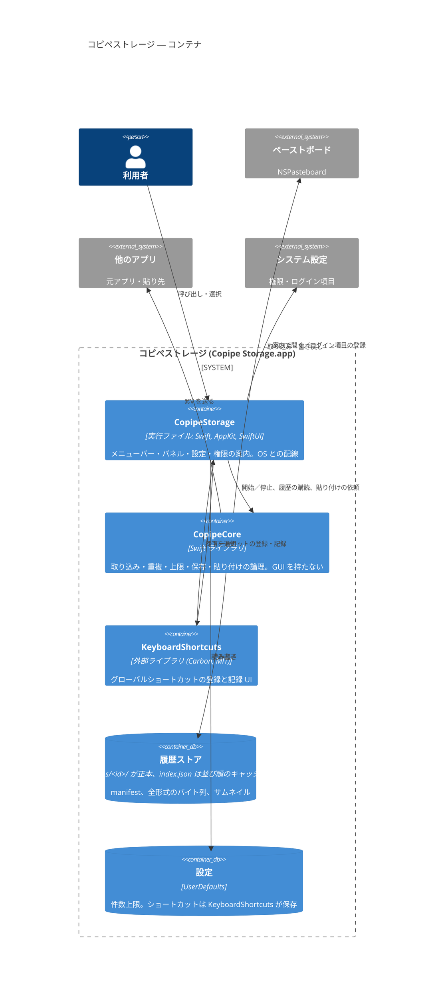
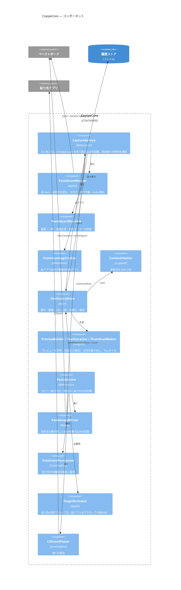
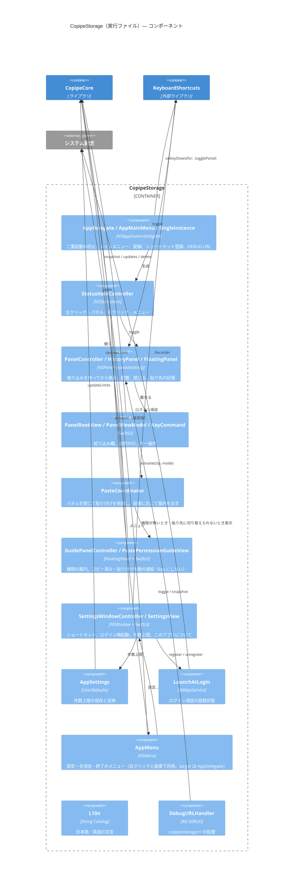

# コピペストレージ — C4 モデル

レベル 1〜3 を Mermaid の C4 記法で持つ。レベル 4（コード）は図を描かず、`Sources/` のコードを正とする。

### レベル 1: システムコンテキスト

### レベル 2: コンテナ

### レベル 3: コンポーネント（CopipeCore）

### レベル 3: コンポーネント（CopipeStorage 実行ファイル）

### レベル 4: コード

図は描かない。`Sources/CopipeCore/Model/` の型（`Clip` / `Representation` / `Limits` / `AppIdentity` など）と `Sources/` の配置が正。部品の名前や責務を変えたときは、このファイルのレベル 3 の図を合わせて更新する。
